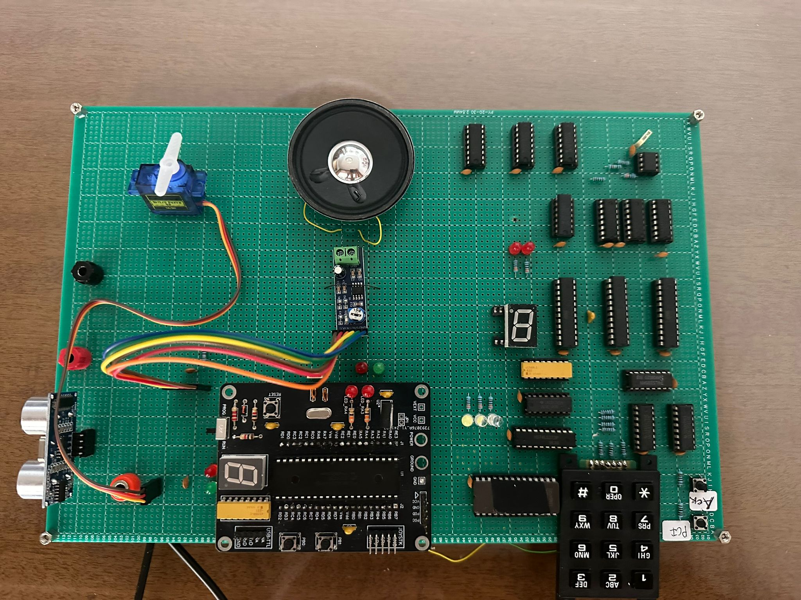
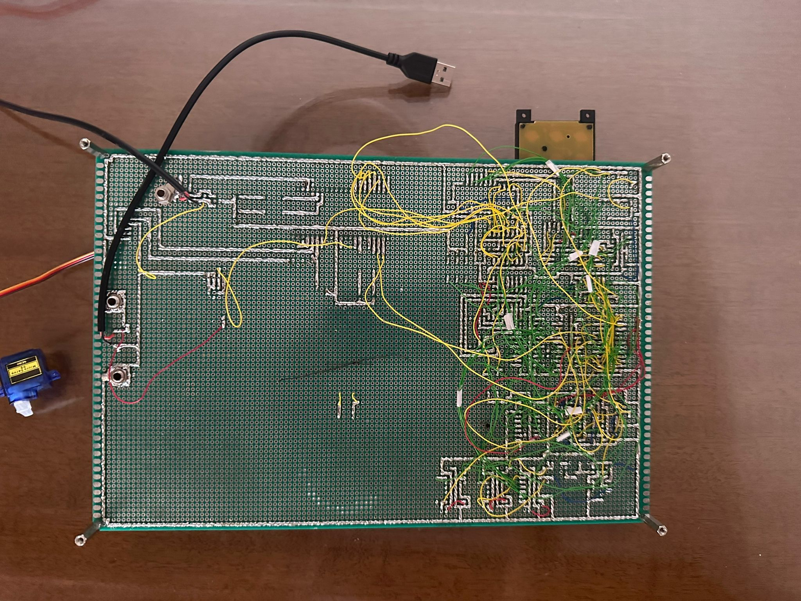

# LSMusical: Ultrasonic Melody Game

A hardware music game built for the *Digital Systems and Microprocessors* course (La Salle, 2024–25).
The player programs a melody of up to 16 notes on a matrix keypad. They then play it back by moving
a hand above an ultrasonic sensor, where each distance band plays a different note. A servo needle
shows the score.

## How it works

The project has two hardware phases that talk to each other over a small handshake bus
(`Note[3..0]`, `Duration[1..0]`, `NewNote`, `StartGame`, `Ack`, `PCI`).

### Phase 1: Note entry (discrete logic)

Built from 74LS-series logic, GAL22V10 chips, a 28C256 EEPROM and an NE555 clock at 1 kHz.

- A 3×4 matrix keypad is scanned. The EEPROM converts the row/column code into the note value
  (0 = Do … 6 = Si) and recognizes `#`.
- Keys are debounced in hardware with a 16 ms wait (no analog filtering).
- The time the key is held sets the note's duration: under 1 s gives 1 s, 1–2 s gives 2 s, and 2 s or more gives 3 s.
  Two LEDs show the duration live, and a 7-segment display shows the note.
- After each note, `NewNote` is raised and the circuit waits for `Ack` from Phase 2.
  After 16 notes, or when `#` is pressed, `StartGame` is raised.

| File | Purpose |
|------|---------|
| `phase1-logic/gal/NAME.PLD` | Main note-entry state machine: next-state equations and control outputs (GAL22V10) |
| `phase1-logic/gal/NOVNAMES.PLD` | Keypad and reset glue logic: key-pressed detection, 16-note counter reset, `Ack` (GAL22V10) |
| `phase1-logic/gal/LOGIC.PLD` | Duration/display state decoding: duration LEDs, display enable, timer resets (GAL22V10) |
| `phase1-logic/gal/*.jed` | Compiled fuse maps, ready to burn |
| `phase1-logic/eeprom/keypad-decoder.hex` | 28C256 EEPROM image that maps keypad codes to note values |

The `.PLD` files are WinCUPL sources. The GALs only do combinational logic. State is held in 74LS flip-flops.

### Phase 2: Game logic (PIC18F4321, assembly)

- Each note/duration pair is stored in RAM as it arrives from Phase 1.
- On `StartGame`, the PIC goes through the melody note by note:
  - It shows the target note on the 7-segment display and its length on two LEDs.
  - It measures hand distance with an HC-SR04-style sensor (`Trigger`/`Echo`). The 0–50 cm range is
    split into 7 equal bands, one for each note.
  - It plays the matching tone on a speaker using software PWM.
  - The player has 3 s to find the note. The note must then match for 500 ms before timing starts,
    and it must keep matching for the full 1/2/3 s duration. A green or red LED shows correct or incorrect.
- A servo (50 Hz PWM, driven from TMR0 interrupts) moves in proportion to the correct notes out of the
  total. At the end, the display shows `-` and the score is held until reset.

| File | Purpose |
|------|---------|
| `phase2-pic/LAB1v2.X/newpic_8b_general.asm` | Full game firmware (MPASM) |
| `phase2-pic/LAB1v2.X/` | MPLAB X project: open this folder in MPLAB X |
| `phase2-pic/lsmusical.hex` | Prebuilt firmware, ready to flash |

Known pin usage: `RB0–RB5` take the note and duration, `RA0` is `NewNote`, `RA1` is `StartGame`, `RC0` is `Ack`
and `PORTD` drives the 7-segment display.

## Building

- **GALs:** open the `.PLD` files in WinCUPL and compile them to `.jed`. Program the chips with any GAL22V10 programmer, such as a TL866.
- **EEPROM:** write `keypad-decoder.hex` to a 28C256.
- **PIC:** open `phase2-pic/LAB1v2.X` in MPLAB X (v5.30 or earlier, because MPASM was removed in v5.40+) and build.
  You can also flash `lsmusical.hex` directly with a PICkit.

## Photos

| Top | Bottom |
|-----|--------|
|  |  |

## Authors

Teodor Arsovski and Mateja Džunić
